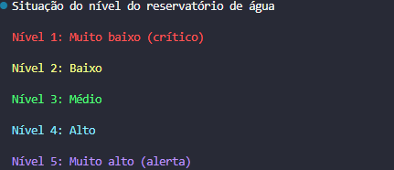

# 💧 Controle de Níveis de Água

## 📌 Sobre o projeto

Este projeto consistem em uma simulçao de monitoramento do nível de água de um reservatório.

📚 O programa utiliza a biblioteca Colorama para exibir mensagens coloridas no terminal, identificando cinco níveis de água e suas respectivas situações. 

## 🎯 Níveis do reservatório

O programa apresenta cinco níveis de água, cada um com uma
mensagem e uma cor correspondente à situação do reservatório.

## 🛠️ Tecnologias utilizadas

🐍 Python 3

📚 Colorama

## ▶️ Como executar

1️⃣Instale a biblioteca Colorama:

pip install colorama

2️⃣Execute o programa no terminal:

python Controle_nivel_agua.py

## 🎓 Objetivo da atividade

Aplicar os conceitos de programação estruturada em Python por meio da simulação de um sistema de monitoramento de níveis de água.

